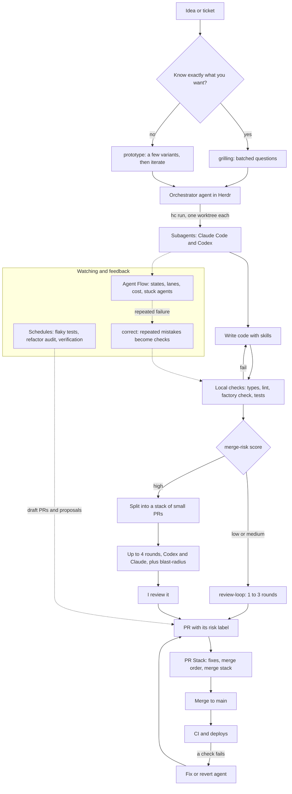

## Two ends of the spectrum

We're at a point where software engineering has two ends of the spectrum. On one end there are huge companies who are only just getting [Claude Code](https://docs.claude.com/en/docs/claude-code/overview) access and starting to use the CLI. They're stuck in a weird pit between the "old way" of hand-writing code and reviewing PRs rigorously. On the other end there are startups, scale-ups and even large tech companies moving incredibly fast, pushing out thousands of PRs a month and not even reviewing the code.

What fills the gap is apparently the "software factory", which everyone (on X at least) is talking about. Here I'll walk through my own setup, and how I've been building (and iterating on) a factory of my own.

## From IDE to ADE

I've tried a few different tools and systems. Right now there's a bit of a shift away from running the Claude Code or [Codex](https://github.com/openai/codex) CLI in a multi-pane terminal (which was itself the original "crazy" shift away from the IDE) towards dedicated apps for orchestrating agents. I've tried a couple of those and think they were a good experience, but I've also tried some more advanced multi-pane setups.

If you've already converted from an IDE user to an ADE user (agent development environment) and don't care much about looking at the code day to day (like me), feel free to skip this part. If not, the conclusion is simple. For most general software engineering, like web dev or full stack TypeScript projects, you don't need to be looking at the code and you don't need to be writing it by hand.

TypeScript is good here because the type system lets the models basically verify whether their code works (compiles), and if it does there's a good chance it's right. That was the original thinking anyway. At this point I think the models are so good at popular languages that you just don't need to be checking the code for bugs at all. The main concerns are whether your intent is captured well enough, and whether someone or something is reviewing the code to catch issues. Both can be handled just by talking to the agent.

## Getting the intent right

In my experience intent can be clarified in two ways.

1. **You know pretty well what you want.** Then get the agent to interview you. Matt Pocock's [grill-me](https://github.com/mattpocock/skills) skill does exactly this. My version is called `grilling`: it asks its questions in batched rounds until there's no open decision left, so you answer five things at once rather than one at a time.
2. **You don't actually have all the answers yet.** Then just get the agent started. Ask for a couple of variants, look at them, and iterate by giving it feedback. The `prototype` skill builds throwaway code for this, either a logic sketch or a few UI options side by side, so you're reacting to something real instead of describing it in the abstract.

A small one I use a lot is `in-your-own-words`, which makes the agent restate what it thinks I'm trying to do before it starts. It catches a surprising number of misunderstandings for about ten seconds of reading.

## The skills stack

Skills are where most of the "factory" actually lives. A skill is just a Markdown file that tells the agent how to do one kind of task, and it loads by itself when a task matches its description. I keep mine in one repo, [rstack](https://github.com/rk68/rstack), and an install script links them into both Claude Code and Codex, so every agent works the same way regardless of model.

Most of them are adapted from three open source sets, with my own on top:

| Source | Skills I use from it | What for |
| --- | --- | --- |
| [pstack](https://github.com/cursor/plugins/tree/main/pstack) by Lauren Tan | `blast-radius`, `benchmark-checklist`, `correct`, `how`, `why`, `figure-it-out`, the formal verification skills | Checking what a change could break, explaining code, turning repeated mistakes into checks |
| [Matt Pocock's skills](https://github.com/mattpocock/skills) | `grilling`, `tdd`, `diagnosing-bugs`, `codebase-design`, `domain-modeling`, `prototype`, `writing-for-agents` | Planning, design, debugging and writing skills themselves |
| [Convex agent skills](https://github.com/convex/agent-skills) | `convex-development`, `convex-review`, `convex-verify` | Our backend: auth checks, validators, and tests that prove the wrong user gets refused |
| My own | `commit-pr`, `typescript-development`, `typescript-review`, `review-loop`, `merge-risk`, `flaky-tests`, `unslop`, the Herdr skills | Commits and PRs, reviews, merge risk, flaky tests, and driving agents inside Herdr |

On top of the skills there's a global rules file that every agent reads. The most useful part of it is a short list of **stop points**: the only things an agent has to ask me about, like changing a shared contract, deleting something it didn't create, spending money, deploying, or merging a PR. Everything else it decides itself and tells me what it decided. That one list removed most of the "should I continue?" interruptions.

There's also a git guardrails hook that blocks commands that lose work or touch production (`git reset --hard`, force pushes, `convex deploy` and so on). The agent sees why it was blocked and asks me to run the command myself if I really want to.

## Turn rules into checks

A rule in a skill is a request. A lint rule is a fact. Wherever I can, I move a rule out of the prose and into a check the agent can run locally or that CI runs, so it gets instant feedback instead of hoping it remembered.

- **A local factory check.** One script runs the repo's ESLint rules, including the official [Convex ESLint rules](https://github.com/convex/agent-skills) and our own custom ones, against a baseline of known issues. Agents must get exit code 0 before they report work as done, so a new violation can't sneak in.
- **`correct` for repeated mistakes.** When an agent makes the same mistake twice, the [pstack](https://github.com/cursor/plugins/tree/main/pstack) `correct` skill turns it into a guardrail: a lint rule, an import boundary, or a test, rather than another line in a skill that might get skipped.
- **The type system.** Discriminated unions instead of piles of booleans mean a whole class of invalid states just doesn't compile. The `typescript-review` skill flags state that should be one status union.
- **Run CI locally, push once.** Every push starts paid CI runners, so the skills run the same checks locally and push once at the end.

The pattern I keep coming back to: if I'm correcting the same thing in review, it should be a check by next week.

## How I actually work now

One thing I've concluded is that closed source ADEs are no good. Agents can build pretty much any piece of software these days, so you should be personalising your ADE. I'd bet money that your use of agents and your tasks are different to mine, so it helps to have your own visualisations and the information you care about at a glance. That's why I don't bother with closed source or restrictive dev tools. Open source is really the way to go.

I really enjoyed [Paseo](https://github.com/getpaseo/paseo), thanks to its mobile app and its worktrees feature for orchestrating multiple agents. Building plugins for it was smooth too, so I could add features like custom PR stacking and merging that fit how I specifically orchestrate agents.

I've since been having a lot of fun with [Herdr](https://herdr.dev). It's seemingly a regression back to terminal and CLI style orchestration, but with mods (its plugins), the ability to build proper visualisations, and a lot of flexibility generally. Its core runs every agent in a terminal that stays alive when the window closes, and a CLI (`hc`) lets one agent start, message and wait on others.

On top of it I've built (and keep building) my own Herdr setup, called [corral](https://github.com/rk68/corral). It's ten mods, a layout, a theme and some key bindings:

- **Agent Flow:** a live view of every agent, subagent and process in a space (more below).
- **PR Stack and PR Diff:** my open PRs in merge order, with risk, blockers and one-click fixes, plus a pane to review a diff in.
- **Schedules:** agents that run on a cadence, since Herdr has no scheduler of its own.
- **Usage:** Claude Code and Codex plan limits in the sidebar, so I can see when I'm about to hit a wall.
- **Plan:** each agent's current plan, pulled from Claude Code and Codex hooks.
- **Activity:** my GitHub contribution calendar in a pixel style, mostly because I wanted it.
- **A Markdown viewer and a file browser,** so specs, plans and statecharts open beside the terminal.

<figure>
<video src="../media/blog/agentic-ade/demo.mp4" poster="../media/blog/agentic-ade/demo-poster.jpg" controls muted loop playsinline preload="metadata"></video>
<figcaption>A 30-second walkthrough of corral, with a Claude Code session and a Codex session making small changes to an example repo.</figcaption>
</figure>

My day looks like this. I keep my orchestrator agent's pane open at all times. I often have around ten subagents across Claude Code and Codex running at once, all managed by that one orchestrator: writing code, reviewing PRs, making fixes, watching CI and deployments, and doing research on the web. The orchestrator raises any decisions to me as needed. Each subagent works in its own git worktree, so they never step on each other.

I also keep a small Claude pane open on the side. Whenever I spot something or have an idea for a new mod, plugin or other feature for my ADE (which is actually quite often), I build it there without disturbing the orchestrator. Most of corral started life in that side pane.

<figure>

</figure>

## Agent Flow: seeing the whole herd

The mod I look at most is Agent Flow. It reads Herdr's terminals plus each agent's own session log, so it knows the model, the tools being called and the subagents running inside each Claude Code or Codex process. It has seven views:

- **Diagram:** who delegated what to whom, and what came back.
- **States:** every agent sits in the state it's in (thinking, reading, editing, waiting, needs you, done), with lines back to the orchestrator. This is my high level view of whether anyone is stuck or needs input from me.
- **Map and Timeline:** the routes and messages between agents over time.
- **Context:** how full each agent's context window is, and when it reset.
- **Lanes:** one row per agent and subagent, with tool calls as ticks over time, its status, and what it has spent so far.
- **Cost:** spend per agent, including subagents, against the share of my weekly plan limit, plus cache health. A cache miss (where an agent pays to write its whole context again) shows as a marker, with the likely reason, like a model switch or a long idle gap.

<figure>

<figcaption>The States view, here on Agent Flow's built-in example data.</figcaption>
</figure>

It also flags agents that **look stuck**: the same call failing three times, the same call looping, a tool hanging for 15 minutes, lots of tool calls with no edits for 20 minutes, repeated context resets, or repeated permission denials.

Lanes and the stuck flags are where I spot processes that need investigating. If one agent keeps failing the same tool call, that's usually a sign I need a new skill or a check, so I hand it to the `correct` skill and it becomes a guardrail rather than a recurring annoyance.

<figure class="pair">

<figcaption>The Map and Timeline views.</figcaption>
</figure>

## Pull requests: merge risk and the PR stack

Recently I added a merge risk classification to every PR: low, medium or high. A small script in the `merge-risk` skill scores the diff on its size, the sensitive paths it touches (schema and migrations, auth, CI and deploy config, payments, backend, dependencies) and whether code changed with no test changes. The agent writes the result onto the PR as a `risk:high` style label and a block in the PR's Risk section. The PR Stack panel imports the same script, so the panel and the agents always agree.

The level decides how much review a PR gets:

| Risk | Agent review | Split first | Me |
| --- | --- | --- | --- |
| Low | One round, one reviewer | No | I usually let it merge |
| Medium | Up to three rounds | No | I usually let it merge |
| High | Up to four rounds, two model families, plus a `blast-radius` pass | Yes | I review it myself |

High risk PRs get split before review into a stack of easily reviewable PRs: one concern each, under about 400 lines, in the order schema, backend, shared code, UI, clean-up. Each slice gets its own test plan and runs the fast checks for the packages it touches, and the full local CI runs once on the top of the stack. That way when something does need my eyes, it's a few files with a clear purpose and I can give feedback quickly.

The review rounds themselves run through the `review-loop` skill: a Codex reviewer and a Claude reviewer read the branch, I (or the orchestrator) verify each finding, they fix the real ones, and the loop stops when both say there's nothing left or the round limit is hit.

The PR Stack panel is where all of this comes together:

- My open PRs in merge order, grouped into stacks, with what blocks each one (CI, conflicts, review comments, a wrong base).
- One-click fixes, including starting an agent to resolve conflicts, fix CI or address review comments. It can do this automatically too.
- **Risk first** sorting, which groups PRs by risk with the ones waiting on my review at the top, and a "waiting 6h" badge on each so nothing quietly ages.
- Merging a whole stack into main one PR at a time.
- The CI and deploy status of every recent merge to main. If a check fails, one button starts an agent that finds the cause and opens a fix PR, and another opens a revert PR.

Clicking a PR's file count opens PR Diff, a pane for reading the diff file by file. Each file has GitHub's own "Viewed" box, so ticking a file in Herdr shows on GitHub too.

<figure>

</figure>

## Schedules: the jobs nobody remembers to do

Some of the most useful agent work is boring and recurring: checking for flaky tests, updating documentation, and making sure the repo hasn't drifted from the file structure and import structure you intended. Herdr has no scheduler of its own, so I built a Schedules mod. Each job is a folder, a cadence (hourly, daily or weekly at a set time) and a prompt, and it starts an agent at that time. A run that was due while the app was closed starts once when it next opens.

The ones I run on our main repo right now:

- **Flaky tests, daily.** The `flaky-tests` skill reads CI history for jobs that failed and then passed on a rerun of the same commit, which is the clearest sign of a flaky test. It then confirms each one locally by running it 30 times in a shuffled order, fixes the root cause (not a retry or a longer timeout), and opens one draft PR per cause. The first run found one CI job that had flaked six times in two weeks.
- **Refactor audit, daily.** The `monorepo-refactor` skill maps the codebase for dead code, duplicated rules, shallow modules and implicit state machines, and writes a dated proposal. It doesn't touch the code: I read the proposal and say which parts to do.
- **Verification upkeep, weekly (next on the list).** Keeps the formal models in the next section in step with the code.

The nice thing about running these as agents instead of cron scripts is that they can fix what they find, and they report in plain English when there's nothing to do.

## Formal verification, without Java

I don't know much about formal verification. I only heard about it from [this video by poteto on X](https://x.com/poteto/status/2102050467505430555).

pstack comes with formal verification skills built on [TLA+](https://lamport.azurewebsites.net/tla/tla.html): pick the part of the code where a bug costs the most and tests reach the least, model it, and let a model checker try every possible order of events. I liked the idea, but we're a TypeScript monorepo, and TLA+ needs Java and its own language. So I tried a TypeScript version first.

The model checker itself is about a hundred lines of TypeScript. You describe the system as states and steps (one step per mutation, scheduled function or outside event), write the rules as invariants, and it explores every reachable state breadth first. If a rule breaks, it gives you the shortest sequence of events that breaks it, plus a statechart. Node runs it directly, so there's nothing to install.

I pointed it at our background job lifecycle: start, cancel, freeze, a deadline timer, the workflow finishing, its completion callback and clean-up, in every order. Within 41 milliseconds it had checked about 5,700 states and found a six-step trace where a run would get cleaned up twice. That looked a lot like some "Workflow not found" errors in our CI logs.

Then I replayed the exact trace as a [convex-test](https://docs.convex.dev/testing/convex-test) case against the real code. It turned out the workflow library finishes a run and calls its callback in the same transaction, so the gap the model assumed never happens. The model was wrong, not the code. I fixed the model and all five rules held.

That's the loop I'd recommend: the model raises a suspicion cheaply, and a real test settles it. Both outcomes are worth knowing. If your models outgrow about a million states, [Quint](https://github.com/informalsystems/quint) is a TypeScript-like spec language whose simulator runs in Node, and [fast-check](https://github.com/dubzzz/fast-check) can run model-based tests that tie a model to the real code.

The statechart renders in the Markdown viewer and re-renders on save, so I can keep it open in a small pane and watch it change as the model does. A proper mod for it is next, with the verification upkeep running on a schedule.

## The whole factory at a glance

Here's how all of it fits together so far. Solid arrows are the path a change takes from idea to production. Dotted arrows are the feedback loops that keep improving the factory itself.

## What's next

The whole point of building it this way is that whenever a constant failure point shows up, I can fix the factory itself rather than working around it. The next few on my list:

- A statechart panel that keeps the models of our application's state machines in view, with the verification upkeep updating them on a daily schedule.
- Feeding "this file is covered by a model" into the merge risk score, so a PR that touches verified code reruns the model check as part of its review.
- More rules moved out of skills and into lint checks, every time I catch myself correcting the same thing twice.

Everything here is open source: the mods are in [corral](https://github.com/rk68/corral) and the skills are in [rstack](https://github.com/rk68/rstack). Take what's useful, and then go build the ADE that fits how *you* work.
